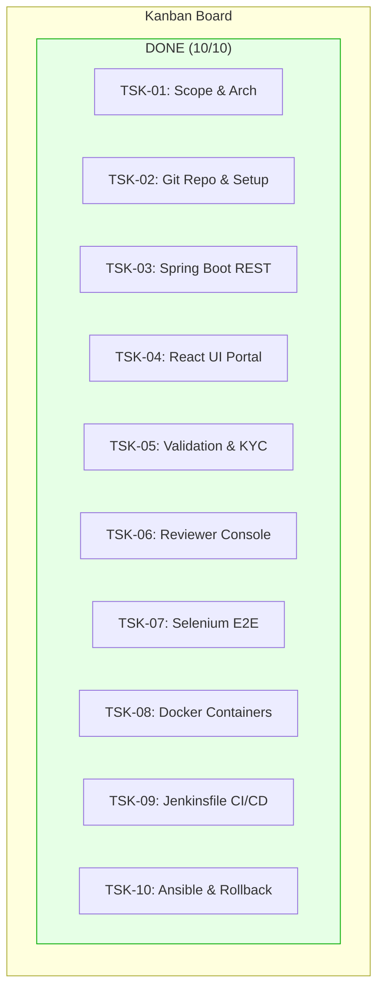

# Agile Planning, Product Backlog, Kanban Board & Definition of Done

**Project**: Automated Broadband Installation Workflow  
**Student**: Pushkar Waykole (Roll Number: 23102C0012)  
**Class**: BE VII, Division C (Academic Year: 2026–2027)  
**Methodology**: Agile Scrum / Kanban Hybrid with Continuous Delivery  

---

## 1. Product Backlog & User Stories

Each user story includes explicit Gherkin-syntax **Acceptance Criteria**.

### User Story 1: Customer Broadband Plan Selection & Order Submission
- **As a** prospective broadband subscriber,  
- **I want to** select a high-speed fiber internet plan and submit my contact and address details,  
- **So that** a technician can install broadband at my premises.  
- **Acceptance Criteria**:
  - *Given* I am logged into the customer portal,
  - *When* I choose a plan (e.g. Gold 300 Mbps) and enter my 10-digit mobile number, email, address, and future preferred installation date,
  - *Then* the system persists the request with a unique tracking code (e.g., `BB-2026-1001`) and sets status to `SUBMITTED`.

### User Story 2: Form Input Validation Rules
- **As a** system reliability engineer,  
- **I want** all user input to be strictly validated on both client and server sides,  
- **So that** bad data (e.g. invalid phone number, past dates) is prevented before persistence.  
- **Acceptance Criteria**:
  - *Given* an applicant enters a phone number with less or more than 10 digits,
  - *When* they click "Submit Order",
  - *Then* the form prevents submission and shows "Contact phone must be an exact 10-digit number".

### User Story 3: KYC & Address Proof Document Upload
- **As a** compliance officer,  
- **I want** customers to attach identity and address proof documents during application,  
- **So that** telecommunications regulatory KYC checks are satisfied.  
- **Acceptance Criteria**:
  - *Given* a customer is submitting an installation request,
  - *When* they attach a valid file (`.pdf`, `.png`, `.jpg`) under 10MB,
  - *Then* the file is stored in `/app/uploads` and linked to the request ID.

### User Story 4: Customer Request Lifecycle Timeline & Status Tracking
- **As a** customer,  
- **I want to** view a real-time visual progress timeline of my request,  
- **So that** I know exactly which stage (Submitted &rarr; Under Review &rarr; Approved / Rejected &rarr; Scheduled) it is currently in.  
- **Acceptance Criteria**:
  - *Given* a reviewer approves or rejects my request,
  - *When* I open my request history table,
  - *Then* the timeline displays completed stages in green, active stage in blue, or rejection in red with the reviewer's justification remarks.

### User Story 5: Reviewer Operational Console & Full-Text Search
- **As an** operations reviewer,  
- **I want to** view operational KPI counts and filter/search incoming applications by customer name, city, or status,  
- **So that** I can prioritize and process requests efficiently.  
- **Acceptance Criteria**:
  - *Given* the reviewer dashboard is open,
  - *When* I filter by `SUBMITTED` or type a city name (e.g. "Pune"),
  - *Then* only matching requests are returned instantly without page reload.

### User Story 6: Reviewer Feasibility & Approval Engine
- **As an** operations officer,  
- **I want to** inspect applicant documents and approve the request with an assigned technician and installation slot,  
- **So that** the field team can be dispatched.  
- **Acceptance Criteria**:
  - *Given* a request in `UNDER_REVIEW`,
  - *When* I click "Approve Request", choose a confirmed date and assign technician "Suresh Patil",
  - *Then* the request transitions to `APPROVED` / `INSTALLATION_SCHEDULED` and writes an audit log.

### User Story 7: Reviewer Rejection with Justification
- **As an** operations officer,  
- **I want to** reject requests that fail feasibility checks with a mandatory justification,  
- **So that** the applicant is transparently informed.  
- **Acceptance Criteria**:
  - *Given* an applicant's building has no spare fiber ports,
  - *When* the reviewer selects "Reject Request" without entering remarks,
  - *Then* the system blocks submission; once remarks are entered, status transitions to `REJECTED`.

### User Story 8: Automated Selenium E2E Regression Suite
- **As a** QA engineer,  
- **I want** automated headless browser tests to run on every code push,  
- **So that** broken user flows are immediately identified before deployment.  
- **Acceptance Criteria**:
  - *Given* a code push to the repository,
  - *When* Maven executes the Selenium test suite,
  - *Then* all 5 critical user journeys pass in headless Chrome; if any fails, a timestamped screenshot is captured in `target/test-screenshots/`.

### User Story 9: Containerized Docker Deployment
- **As a** DevOps engineer,  
- **I want** the entire multi-tier stack (MySQL, Spring Boot, React/Nginx) packaged into versioned Docker containers,  
- **So that** deployment is completely isolated, reproducible, and portable.  
- **Acceptance Criteria**:
  - *Given* Docker and Docker Compose installed,
  - *When* running `docker compose up -d`,
  - *Then* MySQL starts first, followed by Spring Boot (`/api/health` returns HTTP 200), followed by Nginx frontend reverse proxy on port 80.

### User Story 10: Idempotent Ansible Configuration & Automated Rollback
- **As a** release engineer,  
- **I want** Ansible playbooks that provision target servers idempotently and provide instant rollback,  
- **So that** system drift is eliminated and bad releases can be restored in seconds.  
- **Acceptance Criteria**:
  - *Given* an initial Ansible deployment completed,
  - *When* the playbook is rerun without configuration changes,
  - *Then* the task output reports `changed=0`, proving complete idempotency.

---

## 2. 10-Task Kanban Board Plan

| Task ID | Task Description | Assignee | Estimate | Status | Sprint |
| :--- | :--- | :--- | :--- | :--- | :--- |
| **TSK-01** | Define Problem Scope, SRS, ERD & API Architecture | Pushkar W. | 8 hrs | **DONE** | Sprint 1 |
| **TSK-02** | Initialize Git repo, .gitignore, README & GitHub templates | Pushkar W. | 4 hrs | **DONE** | Sprint 1 |
| **TSK-03** | Develop Spring Boot 3 REST API & MySQL / H2 Persistence | Pushkar W. | 16 hrs | **DONE** | Sprint 1 |
| **TSK-04** | Build React 18 Frontend UI, Plan Catalog & Submission Form | Pushkar W. | 16 hrs | **DONE** | Sprint 1 |
| **TSK-05** | Implement Client & Server-Side Input Validation & KYC Upload | Pushkar W. | 8 hrs | **DONE** | Sprint 1 |
| **TSK-06** | Implement Reviewer Operations Console, Decision Engine & Audit Trail | Pushkar W. | 12 hrs | **DONE** | Sprint 2 |
| **TSK-07** | Develop Selenium WebDriver 5-Journey E2E Headless Test Suite | Pushkar W. | 12 hrs | **DONE** | Sprint 2 |
| **TSK-08** | Write Multi-Stage Dockerfiles & Docker Compose Orchestration | Pushkar W. | 8 hrs | **DONE** | Sprint 2 |
| **TSK-09** | Author Parameterized Jenkinsfile CI/CD Pipeline as Code | Pushkar W. | 10 hrs | **DONE** | Sprint 2 |
| **TSK-10** | Develop Idempotent Ansible Playbook & Automated Rollback Script | Pushkar W. | 8 hrs | **DONE** | Sprint 2 |

---

## 3. Sprint Plan

### Sprint 1: Core System Architecture & Customer Submission Flow (2 Weeks)
- **Goal**: Establish the foundational infrastructure, database models, REST APIs, and customer submission workflow.
- **Completed Deliverables**:
  - Git repository initialization with branching strategy.
  - Spring Boot 3 backend with H2/MySQL database schema and JPA entities.
  - Customer submission form with real-time validation and KYC upload.
  - Initial unit and integration tests.

### Sprint 2: Reviewer Console, DevOps Automation & Continuous Delivery (2 Weeks)
- **Goal**: Implement reviewer decision engine, Selenium E2E testing, Docker containerization, Jenkins CI/CD pipeline, and Ansible automated deployment.
- **Completed Deliverables**:
  - Reviewer dashboard with filters, feasibility actions, and audit logging.
  - Selenium WebDriver 5-journey automated test suite with failure screenshots.
  - Multi-stage Docker builds and Docker Compose file.
  - Parameterized Jenkinsfile pipeline with automated test gating and rollback.
  - Idempotent Ansible playbooks and rollback script.

---

## 4. Definition of Done (DoD) Checklist

To ensure all deliverables meet production standards, a feature or task is classified as **Done** only when:
- [x] **Code Quality**: Code follows established coding standards, naming conventions, and clean architectural patterns.
- [x] **Unit Testing**: All backend JUnit 5 unit and integration tests pass with zero errors (`mvn test`).
- [x] **E2E Browser Testing**: All 5 Selenium WebDriver journeys execute successfully in headless mode (`mvn test -Dheadless=true`).
- [x] **Validation Rules**: Client-side and server-side validation rules enforced on all input fields.
- [x] **Version Control**: Changes committed on a dedicated feature branch with descriptive commit messages and merged via pull request.
- [x] **Merge Conflict Evidence**: Deliberate merge conflict created and resolved cleanly with version tag `v1.0.0`.
- [x] **Containerization**: Multi-stage Docker builds complete successfully without root user vulnerabilities.
- [x] **CI/CD Pipeline**: Jenkinsfile stages (Checkout, Build, Package, Selenium Test, Docker Build, Deploy, Health Check) pass cleanly.
- [x] **Idempotency**: Ansible playbook executes repeatedly with `changed=0` on subsequent runs.
- [x] **Automated Rollback**: Rollback mechanism verified to restore previous stable image tag upon simulated health failure.
- [x] **Documentation**: SRS, Architecture, DevOps diagrams, API spec, and evidence documents committed to repository.
