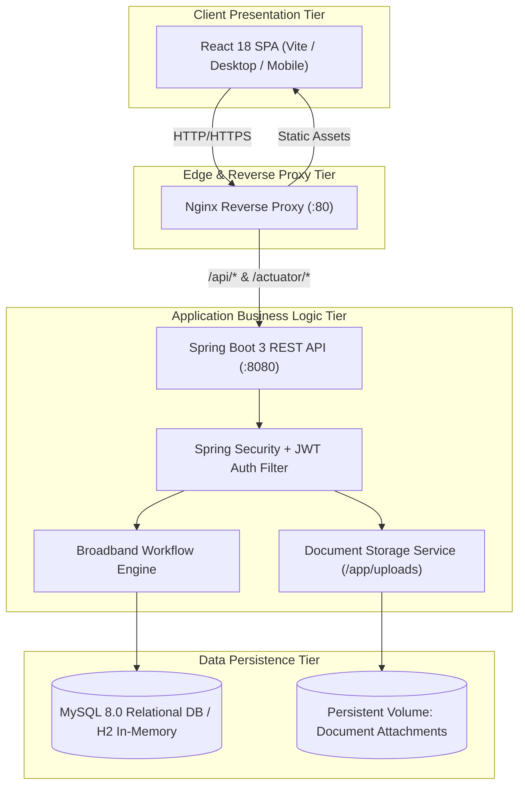
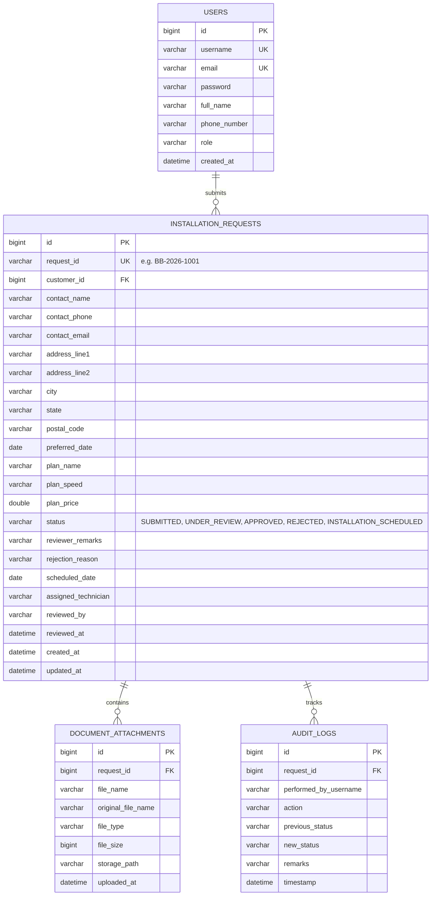

# System Architecture & REST API Documentation

**Project**: Automated Broadband Installation Workflow  
**Student**: Pushkar Waykole (Roll No: 23102C0012)  
**Academic Year**: 2026–2027

---

## 1. System Architecture

The application adopts a three-tier decoupled micro-architecture composed of a React SPA presentation layer, a stateless Spring Boot REST API business logic layer with Spring Security & JWT, and a relational persistence layer (MySQL / H2).

---

## 2. Database Entity Relationship Diagram (ERD)

---

## 3. REST API Specification

### Authentication & User Management
| Method | Endpoint | Access | Description |
| :--- | :--- | :--- | :--- |
| `POST` | `/api/auth/register` | Public | Register customer or reviewer account |
| `POST` | `/api/auth/login` | Public | Authenticate user, receive JWT Bearer token |
| `GET` | `/api/auth/me` | Authenticated | Retrieve authenticated user profile |

### Broadband Installation Requests
| Method | Endpoint | Access | Description |
| :--- | :--- | :--- | :--- |
| `POST` | `/api/requests` | Customer | Submit new installation request |
| `GET` | `/api/requests/my-requests` | Customer | Fetch logged-in customer's submitted orders |
| `GET` | `/api/requests/{id}` | Customer / Reviewer | Retrieve full request details with documents & audit history |
| `GET` | `/api/requests/reviewer/all` | Reviewer / Admin | List all requests with status and text query filters |
| `PUT` | `/api/requests/reviewer/{id}/review` | Reviewer / Admin | Record review decision (Under Review, Approve, Reject, Schedule) |
| `GET` | `/api/requests/analytics/stats` | Reviewer / Admin | Fetch aggregated operational KPIs |

### Supporting Documents
| Method | Endpoint | Access | Description |
| :--- | :--- | :--- | :--- |
| `POST` | `/api/documents/upload/{requestId}` | Customer | Upload KYC or address proof document |
| `GET` | `/api/documents/download/{id}` | Authenticated | Stream / download attached proof file |

### Infrastructure & Health
| Method | Endpoint | Access | Description |
| :--- | :--- | :--- | :--- |
| `GET` | `/api/health` | Public | Returns service health status, version, and metadata |
| `GET` | `/actuator/health` | Public | Spring Boot Actuator health check |
