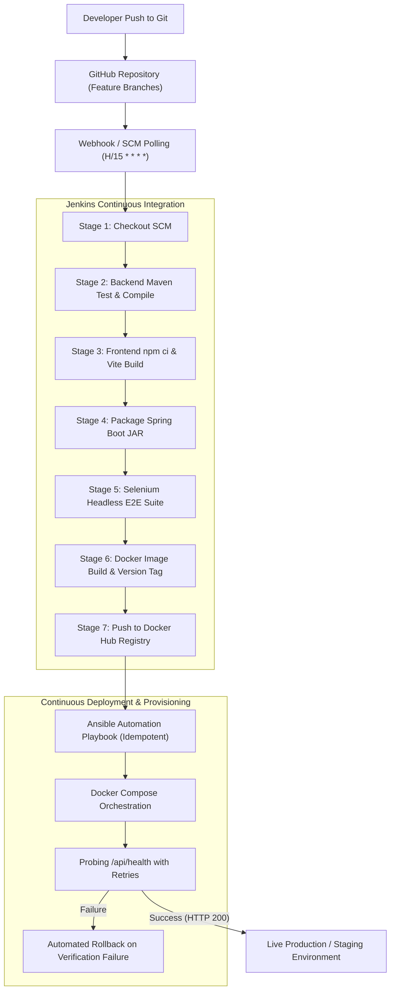

# DevOps Engineering & Continuous Delivery Architecture

**Project**: Automated Broadband Installation Workflow  
**Student**: Pushkar Waykole (Roll No: 23102C0012)  
**Academic Year**: 2026–2027

---

## 1. DevOps Lifecycle Architecture

---

## 2. Selenium WebDriver Automated Testing Strategy

The project features a dedicated automated testing suite in `tests/selenium`:
- **Headless Chrome Execution**: Executes with `--headless=new`, `--no-sandbox`, and `--disable-gpu` for consistent execution in headless Linux CI/CD agents.
- **Page Object Model (POM)**: Enforces separation between UI locators and test assertions.
- **Five Mandatory Test Journeys**:
  1. `testUserLoginAndLogout`: Verifies authentication, JWT receipt, role-specific view rendering, and logout.
  2. `testValidBroadbandRequestSubmission`: Submits an installation order, verifies database persistence and table insertion.
  3. `testInvalidRequestValidation`: Ensures client- and server-side validation rules reject invalid numbers and formats.
  4. `testReviewerApprovalWorkflow`: Reviewer logs in, evaluates feasibility, enters remarks, and marks the request as `APPROVED`.
  5. `testCustomerStatusTracking`: Tests the real-time visual progress timeline and audit trail display.
- **Failure Artifacts**: An automatic JUnit 5 `TestWatcher` captures timestamped PNG screenshots to `tests/selenium/target/test-screenshots/` whenever any test fails.

---

## 3. Docker Containerization Architecture

- **Multi-stage Builds**:
  - `Dockerfile.backend`: Compiles Java 21 via Maven Alpine, producing a minimal non-root Temurin JRE runtime image with built-in `HEALTHCHECK`.
  - `Dockerfile.frontend`: Installs dependencies via `npm ci`, compiles production static assets with Vite, and serves via Nginx Alpine reverse proxy.
- **Docker Compose Orchestrator**:
  - `telecom-mysql-db`: Persistent storage volume `mysql_data` with `mysqladmin` ping health checks.
  - `telecom-backend-api`: Depends on database health before starting, mounts `uploads_data` volume for document attachments.
  - `telecom-frontend-web`: Depends on backend health, proxies all `/api/` traffic to Spring Boot.

---

## 4. Ansible Configuration Management

- **Idempotency**: The `ansible/playbook.yml` ensures repeated executions result in `changed=0` when no configuration has drifted.
- **Roles**:
  - `roles/docker`: Updates OS package caches, installs Docker, Docker Compose, curl, and provisions the `telecom` system user.
  - `roles/app`: Provisions deployment directories (`/opt/broadband-workflow`), templates `.env.j2`, copies Compose files, starts containers, and validates service health via the `ansible.builtin.uri` module.
- **Automated Rollback (`ansible/rollback.yml`)**: Can be invoked on demand or via CI post-actions to revert `.env` to the prior stable `IMAGE_TAG` and restart containers.

---

## 5. Jenkins Credentials Management

No passwords, database secrets, or API tokens are hardcoded:
- Docker Hub Registry credentials: `withCredentials([usernamePassword(credentialsId: 'dockerhub-credentials', ...)])`
- Application database passwords: Injected via `.env` files or Jenkins parameterized secrets.
