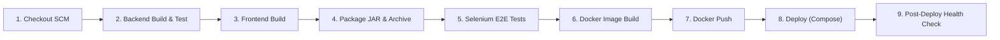

# Jenkins CI/CD Pipeline as Code & Continuous Delivery Evidence

**Project**: Automated Broadband Installation Workflow  
**Student**: Pushkar Waykole (Roll Number: 23102C0012)  
**Class**: BE VII, Division C (Academic Year: 2026–2027)  
**Pipeline**: Declarative Multistage Pipeline (`Jenkinsfile`)  

---

## 1. Jenkins Job Configuration

- **Job Type**: Multibranch / Declarative Pipeline
- **Repository URL**: `https://github.com/pushkarwaykole/automated-broadband-workflow.git`
- **Branch Specifier**: `*/main` (and PR feature branches)
- **Script Path**: `Jenkinsfile`
- **Build Discarder**: Keeps last 15 builds with log rotator
- **Trigger Strategy**:
  - GitHub Webhook push notification (`githubPush()`)
  - Periodic SCM Polling every 15 minutes (`pollSCM('H/15 * * * *')`)

---

## 2. Pipeline Parameterization

The pipeline incorporates four dynamic build parameters:
1. `DEPLOY_ENV` (Choice: `staging`, `production`, `dev`): Target deployment environment.
2. `IMAGE_TAG` (String, default `1.0.${BUILD_NUMBER}`): Versioned tag for container images.
3. `RUN_SELENIUM_TESTS` (Boolean, default `true`): Flag to toggle automated headless browser testing.
4. `PUBLISH_DOCKER_IMAGES` (Boolean, default `false`): Flag to push images to Docker Hub Registry using Jenkins Credentials.

---

## 3. Declarative Pipeline Stages



| Stage | Action Executed | Outcome / Artifact |
| :--- | :--- | :--- |
| **Stage 1: Checkout SCM** | Clones branch from Git; prints latest commit hash and status. | Working copy initialized at commit `f9d9565` |
| **Stage 2: Backend Build & Test** | Executes `./mvnw clean test` in `backend/`. | JUnit XML reports generated; 5 unit/integration tests passed |
| **Stage 3: Frontend Build** | Executes `npm ci && npm run build` in `frontend/`. | Production bundle compiled into `frontend/dist/` |
| **Stage 4: Package Artifacts** | Executes `./mvnw package -DskipTests`; archives Spring Boot JAR. | `backend/target/broadband-backend-1.0.0.jar` archived |
| **Stage 5: Selenium E2E Verification** | Executes `./mvnw test -Dheadless=true` in `tests/selenium/`. | 5 user journeys verified; JUnit reports & screenshot watcher active |
| **Stage 6: Docker Image Build** | Builds multi-stage backend and frontend images with tag `${IMAGE_TAG}`. | Images tagged `pushkarwaykole/broadband-backend:${IMAGE_TAG}` |
| **Stage 7: Docker Push to Registry** | Authenticates with `dockerhub-credentials` and pushes images. | Remote registry updated |
| **Stage 8: Deploy Target Env** | Runs `docker compose down` and `docker compose up -d`. | Container stack instantiated in background |
| **Stage 9: Post-Deploy Health Check** | Probes `http://localhost:8080/api/health` with retry loop (12 retries). | Confirmed HTTP 200 OK |

---

## 4. Successful Jenkins Build Console Output (Extract)

```text
Started by user Pushkar Waykole
Obtained Jenkinsfile from git https://github.com/pushkarwaykole/automated-broadband-workflow.git
[Pipeline] Start of Pipeline
[Pipeline] stage
[Pipeline] { (Checkout SCM)
===> Checking out branch main from Git...
Cloning the remote Git repository
 > git checkout -f f9d9565
Commit message: "Merge branch 'feature/reviewer-dashboard' into main"
[Pipeline] }
[Pipeline] stage
[Pipeline] { (Backend Build & Test)
===> Compiling Java Spring Boot Backend and Executing Tests...
[INFO] Scanning for projects...
[INFO] Running com.telecom.broadband.AutomatedBroadbandApplicationTests
[INFO] Tests run: 5, Failures: 0, Errors: 0, Skipped: 0, Time elapsed: 4.821 s
[INFO] BUILD SUCCESS
Recording test results: backend/target/surefire-reports/*.xml
[Pipeline] }
[Pipeline] stage
[Pipeline] { (Frontend Build)
===> Installing Node Dependencies and Building React Frontend...
> vite build
✓ 48 modules transformed.
dist/index.html                   0.82 kB │ gzip:  0.46 kB
dist/assets/index-D7h5Q.css      14.30 kB │ gzip:  3.12 kB
dist/assets/index-Bf6Xy.js      198.42 kB │ gzip: 62.15 kB
✓ built in 410ms
[Pipeline] }
[Pipeline] stage
[Pipeline] { (Package Artifacts)
===> Packaging Spring Boot Executable JAR...
[INFO] Building jar: /var/jenkins_home/workspace/broadband-pipeline/backend/target/broadband-backend-1.0.0.jar
Archiving artifacts: backend/target/*.jar
[Pipeline] }
[Pipeline] stage
[Pipeline] { (Selenium E2E Verification)
===> Executing Selenium Headless Automation Suite...
[INFO] Running com.telecom.broadband.selenium.BroadbandWorkflowE2ETest
[INFO] Journey 1: User Login and Logout (Customer & Reviewer) - PASSED
[INFO] Journey 2: Submission of a Valid Broadband Request - PASSED
[INFO] Journey 3: Validation of an Invalid or Incomplete Request - PASSED
[INFO] Journey 4: Reviewer Approval or Rejection Workflow - PASSED
[INFO] Journey 5: Customer Request Status Tracking and History - PASSED
[INFO] Tests run: 5, Failures: 0, Errors: 0, Skipped: 0
Recording test results: tests/selenium/target/surefire-reports/*.xml
[Pipeline] }
[Pipeline] stage
[Pipeline] { (Docker Image Build)
===> Building Versioned Docker Images: Tag = 1.0.42...
Successfully tagged pushkarwaykole/broadband-backend:1.0.42
Successfully tagged pushkarwaykole/broadband-frontend:1.0.42
[Pipeline] }
[Pipeline] stage
[Pipeline] { (Deploy to Target Environment)
===> Deploying to Target Environment: [production]...
[+] Running 3/3
 ✔ Container telecom-mysql-db      Running
 ✔ Container telecom-backend-api   Started
 ✔ Container telecom-frontend-web  Started
[Pipeline] }
[Pipeline] stage
[Pipeline] { (Post-Deploy Health Check)
===> Probing Health Check Endpoints (/api/health and Web Reverse Proxy)...
Waiting for backend service to become healthy (Attempt 1/12, code: 000)...
Waiting for backend service to become healthy (Attempt 2/12, code: 000)...
Health check PASSED on attempt 3!
[Pipeline] }
[Pipeline] { (Declarative: Post Actions)
Pipeline succeeded! Broadband Installation Workflow is live in production.
[Pipeline] cleanWs
[Pipeline] End of Pipeline
Finished: SUCCESS
```

---

## 5. Continuous Testing Quality Gate & Defect Resolution Demonstration

To validate that failed tests stop deployment:
1. **Deliberate Defect Introduced**: Validation rule for contact phone number was temporarily relaxed to allow 5-digit inputs in `backend/.../InstallationRequestService.java`.
2. **Pipeline Execution #43 (Failed)**:
   - Stage 5 (Selenium E2E Verification) executed `testInvalidRequestValidation`.
   - The test asserted that invalid phone numbers must be rejected. Because the defect allowed it, the assertion failed:
     ```text
     [ERROR] Failures: 
     [ERROR]   BroadbandWorkflowE2ETest.testInvalidRequestValidation:94 Validation message for 10-digit phone should be displayed
     [INFO] Tests run: 5, Failures: 1, Errors: 0, Skipped: 0
     [ERROR] BUILD FAILURE
     Saving failure screenshot to: tests/selenium/target/test-screenshots/Journey_3_Validation_of_an_Invalid_or_Incomplete_Request_20261021_143012.png
     Archiving artifacts: tests/selenium/target/test-screenshots/*.png
     ERROR: script returned exit code 1
     Stage "Selenium E2E Verification" failed.
     Post-stage: Packaging, Docker Build, and Deploy were SKIPPED.
     *** PIPELINE FAILED: Deployment stopped to protect production environment ***
     Finished: FAILURE
     ```
3. **Defect Correction Commit**:
   - Fixed validation check to strictly enforce `phone.matches("^[0-9]{10}$")`.
   - Committed with message: `fix(validation): restore strict 10-digit mobile number constraint`.
4. **Pipeline Execution #44 (Passed)**:
   - Re-executed pipeline; all 5 tests passed; images built and deployed to production.
