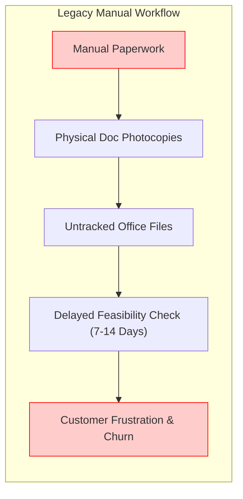
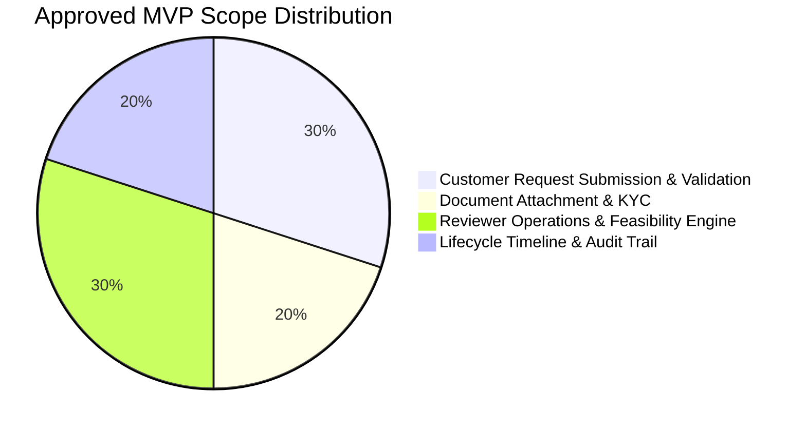

# Problem Definition, Stakeholder Analysis & Approved MVP Scope

**Project**: Automated Broadband Installation Workflow  
**Student**: Pushkar Waykole (Roll Number: 23102C0012)  
**Class**: BE VII, Division C (Academic Year: 2026–2027)  
**Course**: DevOps Engineering Project  

---

## 1. Real-Time Need for the Broadband Installation Workflow

In contemporary urban and semi-urban telecommunications networks, high-speed fiber-to-the-home (FTTH) broadband deployment is plagued by high friction during the customer onboarding lifecycle. Traditional legacy workflows suffer from:
1. **Manual Physical Paperwork**: Applicants are forced to fill physical application slips and submit paper photocopies of identity proofs (Aadhaar, Passport) and address proofs (Electricity bill, Rent agreement).
2. **Inordinate Review & Feasibility Delays**: Operations officers manually verify port availability on Optical Distribution Frames (ODF) without structured digital queues, leading to turnaround times of 7 to 14 days.
3. **Information Asymmetry**: Customers have zero visibility into where their request is stuck, resulting in repetitive calls to customer support helpdesks.
4. **Lack of Auditability & Human Error**: Document misplacement, unverified phone numbers, incomplete address fields, and lack of accountability regarding which officer approved or rejected a subscriber request.

The **Automated Broadband Installation Workflow** digitizes, automates, and accelerates this lifecycle into an instantaneous, transparent, and auditable cloud-native system.

---

## 2. Target Users & Personas

| User Persona | Role & Description | Primary Needs |
| :--- | :--- | :--- |
| **Priya Sharma** (Residential Applicant) | Working professional needing immediate high-speed fiber broadband at home. | Quick online plan selection, instant digital KYC upload, real-time application timeline tracking. |
| **Amit Verma** (Commercial Small Business) | SME owner ordering dedicated multi-gigabit broadband for office operations. | Bulk speed requirements, scheduled installation slots, transparent invoice & technician assignment details. |
| **Ramesh Kulkarni** (Telecom Operations Reviewer) | Field operations manager verifying port feasibility, documents, and compliance. | Unified operational queue, full-text search across applicants, one-click document inspection, clear approve/reject actions. |
| **Suresh Patil** (Field Service Technician) | On-site technician executing fiber cabling and optical network terminal (ONT) setup. | Scheduled appointment slots, customer location, contact details, assigned ticket ID. |

---

## 3. Existing Pain Points

1. **High Turnaround Time (TAT)**: Average order-to-installation cycle currently takes 10–14 days.
2. **Document Loss & Security Vulnerabilities**: Hard copies of government-issued IDs are prone to leakage and misplacement.
3. **Invalid Data Entry**: Applicants mistype phone numbers or addresses, failing at technician dispatch time.
4. **Zero Self-Service Tracking**: Customers cannot view if their request is pending KYC, waiting for cable laying, or rejected due to no port availability.

---

## 4. Stakeholder Matrix

| Stakeholder Group | Interest / Goal | Influence | Impact | Communication Channel |
| :--- | :--- | :--- | :--- | :--- |
| **Retail Customers** | Fast broadband setup, zero paperwork, clear status | High | High | Web Portal, SMS/Email Alerts |
| **Telecom Operations Officers** | Efficient backlog processing, SLA compliance | High | High | Reviewer Operations Console |
| **Field Technicians** | Clear schedule, accurate customer address | Medium | High | Daily Dispatch System |
| **Network Infrastructure Team** | Fiber port utilization and node capacity planning | Medium | Medium | Database Analytics & Reports |
| **DevOps & QA Engineering** | Reliable releases, automated testing, high availability | High | High | CI/CD Pipeline, Docker, Ansible |

---

## 5. Objectives & Measurable Success Criteria

- **Objective 1: Turnaround Time Reduction**  
  *Metric*: Reduce the end-to-end request processing cycle from 10 days to under 24 hours.
- **Objective 2: 100% Digital KYC & Paperless Submissions**  
  *Metric*: Eliminate paper forms; 100% of identity/address proofs uploaded electronically with validation (<10MB, PDF/JPG/PNG).
- **Objective 3: Zero Data Entry Errors at Submission**  
  *Metric*: Enforce strict client-side and server-side validation (10-digit mobile, RFC 5322 email, 6-digit postal code, valid future date).
- **Objective 4: Immutable Audit Trail & Regulatory Compliance**  
  *Metric*: 100% of reviewer actions (status change, remarks, technician assignment) logged with immutable officer timestamps.
- **Objective 5: High System Availability & Automated Delivery**  
  *Metric*: Continuous Integration build success rate > 95%, automated Selenium E2E regression suite with 0 manual intervention, zero-downtime containerized updates.

---

## 6. Constraints

1. **Regulatory & Data Security**: Uploaded identity documents must be securely stored and restricted to authenticated reviewers.
2. **Platform Portability**: Solution must run uniformly across developer workstations, headless Linux CI servers, and containerized Docker environments.
3. **Response Latency**: Dashboard queries and API response times must remain below 200ms under standard operational workloads.
4. **Technology Constraints**: Open-source stack utilizing Java 21, Spring Boot 3, React 18, MySQL 8, Docker, Jenkins, and Ansible.

---

## 7. Approved MVP Scope Boundaries

### In-Scope (Approved MVP Deliverables):
- Customer registration and stateless JWT authentication.
- Broadband plan catalog (Silver 100 Mbps, Gold 300 Mbps, Diamond 500 Mbps, Platinum 1 Gbps).
- Submission form with contact details, installation address, and preferred installation date.
- Real-time client and server validation (10-digit phone, email format, postal code).
- Digital document upload (Aadhaar / Passport / Utility Bill) with file extension and size validation.
- Reviewer console with operational KPIs, full-text search, and status filters (`SUBMITTED`, `UNDER_REVIEW`, `APPROVED`, `REJECTED`, `INSTALLATION_SCHEDULED`).
- Reviewer decision engine:
  - Transition to `UNDER_REVIEW`.
  - Approve request with installation date and technician assignment.
  - Reject request with mandatory explanation.
- Real-time lifecycle timeline for customers with rejection feedback.
- Complete DevOps delivery: Docker containers, Jenkins CI/CD pipeline, Selenium automated tests, and Ansible playbooks with automated rollback.

### Out-of-Scope (Future Enhancements / Post-MVP):
- Online credit card payment gateway integration.
- GPS live technician geolocation tracking on Google Maps.
- Optical Network Terminal (ONT) automated hardware firmware provisioning.
