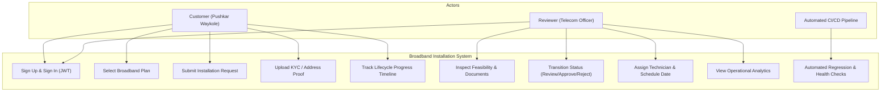
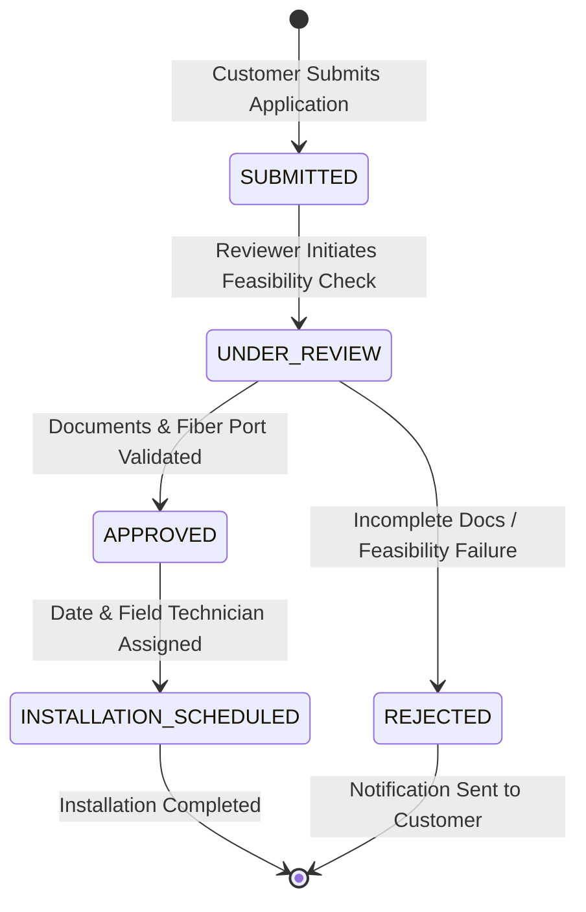

# Software Requirements Specification (SRS) & Use Case Models

**Project**: Automated Broadband Installation Workflow  
**Student**: Pushkar Waykole (Roll No: 23102C0012)  
**Class**: BE VII, Division C (Academic Year: 2026–2027)

---

## 1. Executive Summary

The **Automated Broadband Installation Workflow** replaces fragmented manual telecommunications connection paperwork with a unified, cloud-native digital workflow engine. It governs the end-to-end lifecycle of customer broadband subscriptions from initial application, geolocation and contact validation, document proof verification, reviewer feasibility analysis, decision recording, and automated technician dispatch scheduling.

---

## 2. System Actors

| Actor | Role Description | Permissions |
| :--- | :--- | :--- |
| **Customer** | End-user applying for high-speed fiber broadband | Register, authenticate, select broadband tier, submit contact/address details, upload identity/address verification documents, track real-time application lifecycle timeline, view reviewer remarks and rejection reasons. |
| **Reviewer** | Telecommunications Engineer / Operations Officer | Access operational analytics, filter requests across statuses, inspect uploaded documents, run feasibility tests, approve requests with assigned technicians, or reject requests with mandatory explanations. |
| **System / CI/CD** | Jenkins, Ansible, Docker, Automated Selenium Suite | Continuous integration, unit testing, automated browser verification, container builds, idempotent server provisioning, health probing, and automated rollback. |

---

## 3. Functional Requirements

- **FR-1: Authentication & Authorization**: Stateless JWT token authentication with BCrypt hashed passwords and role separation (`ROLE_CUSTOMER`, `ROLE_REVIEWER`).
- **FR-2: Request Submission & Validation**: Multi-step customer submission validating 10-digit mobile numbers, RFC 5322 emails, postal codes, and preferred installation dates.
- **FR-3: Supporting Document Verification**: Upload and storage of identity and address proofs with size limits (<10MB) and extension checks (`.pdf`, `.png`, `.jpg`).
- **FR-4: Reviewer Decision Engine**: State transitions across `SUBMITTED` &rarr; `UNDER_REVIEW` &rarr; `APPROVED` / `REJECTED` &rarr; `INSTALLATION_SCHEDULED`.
- **FR-5: Immutable Audit Logging**: Automatic persistence of timestamped event logs recording the acting officer, status change, and remarks.
- **FR-6: Real-time Lifecycle Timeline**: Visual progress tracking showing completed stages, active steps, and feedback.
- **FR-7: Operations Dashboard KPIs**: Real-time aggregation of total submissions, pending reviews, approved orders, rejected requests, and scheduled field dispatches.

---

## 4. Use Case Diagram (Mermaid)

---

## 5. State Machine Diagram

